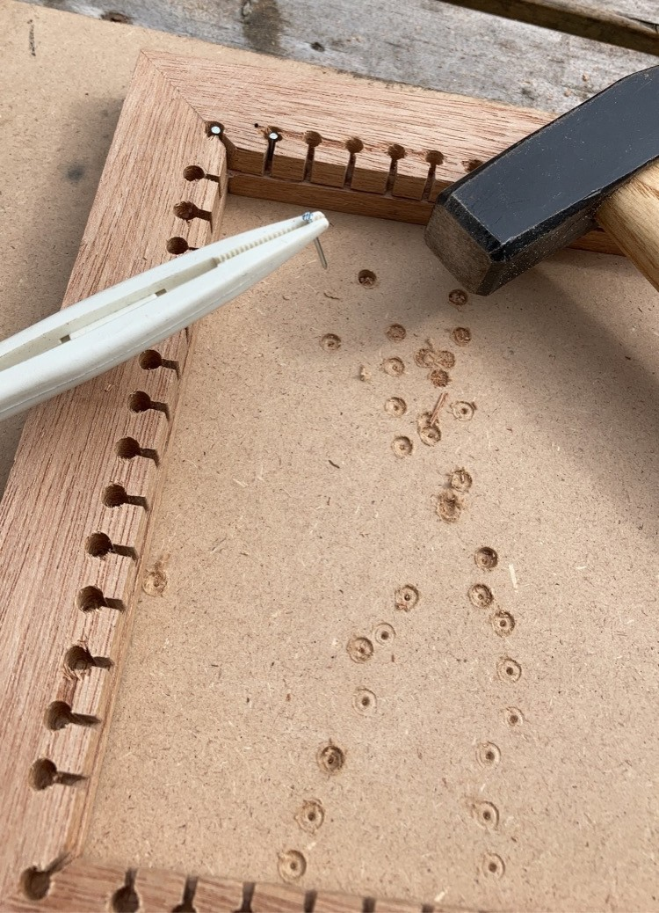
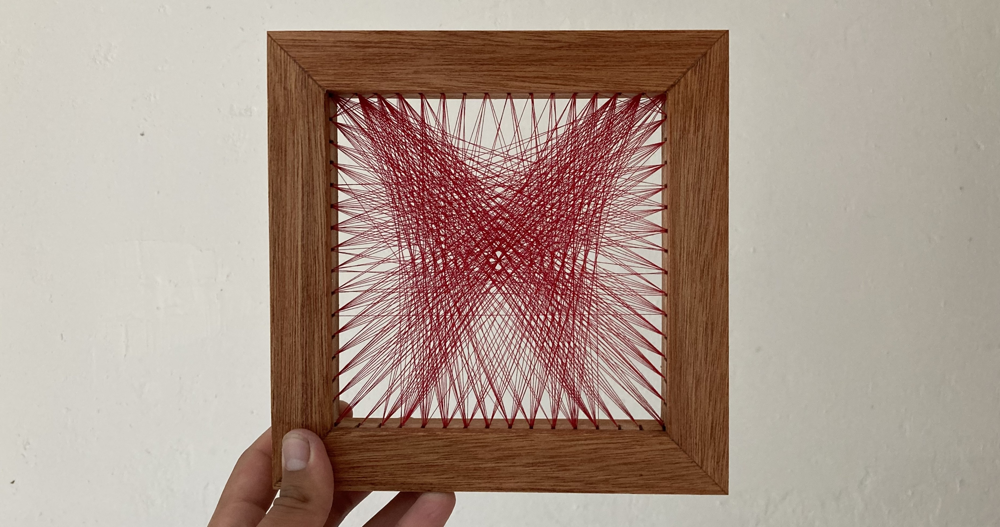

For this project, an algorithm was written to recreate simple images using fixed points on a frame and yarn suspended between them. This algorithm functions as follows:

```plaintext
1. Initialize an array of zeros with the same width and height as the target image.
2. Select a starting point on one of the frame's borders.
3. For every possible endpoint on the other borders:
   a. Draw a line between the starting point and endpoint.
   b. Add a small value to the array for every pixel along the line.
   c. Subtract the updated array from the target image.
   d. Calculate the sum of the resulting image.
4. Select the line that produces the lowest sum.
   This line is the optimal next line.
5. Permanently add the selected line to the array.
6. Move the starting point to the selected line's endpoint.
7. Repeat steps 3–6 until the desired reconstruction is achieved.
```

The progression of this process is shown below using an image of a butterfly as the input.

  

Using this algorithm, a list of instructions was constructed for threading a piece of yarn to obtain the image above. A three-part wooden frame was made to conceal the nails around which the yarn was threaded. The result, which ended up being a gift for my mother, is shown below.

<div style="
  display: flex;
  width: 100%;
  gap: 1em;
  aspect-ratio: 2.36 / 1;
  align-items: stretch;
  margin-top: -1em;
">
  

  
</div>